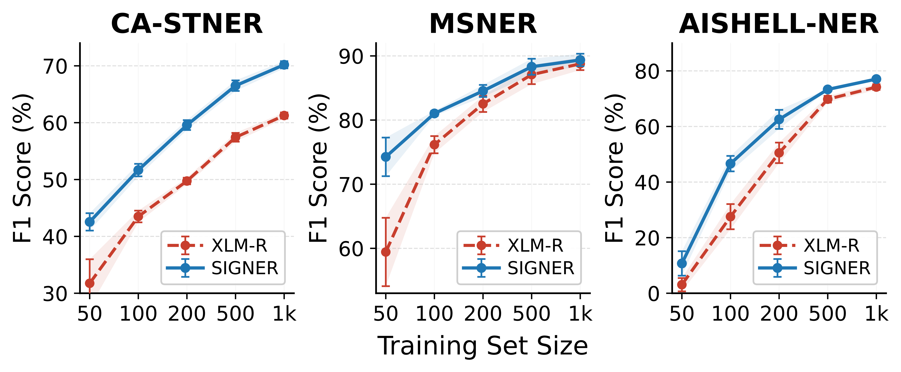

<div align="center">

# SIGNER

### Privileged Acoustic–Text Fusion for Low-Resource Multilingual Named Entity Recognition

**Learn from speech. Deploy with text.**

[](pyproject.toml)
[](requirements.txt)
[](LICENSE)
[](https://github.com/PaErHaTi-DUTiR/SIGNER-main/actions/workflows/release-checks.yml)

[Overview](#overview) · [Results](#results) · [Quick start](#quick-start) · [CA-STNER](#ca-stner) · [Training](docs/TRAINING.md) · [Citation](#citation)

</div>

## Overview

SIGNER uses paired speech as **privileged information during training** to improve multilingual NER on transcripts. At deployment, it requires **text only**: no audio, ASR decoder, speech encoder, or fusion module is loaded.

<p align="center"></p>

- **Text-anchored residual fusion:** text tokens query acoustic frames, with a learned gate controlling the residual update.
- **Dual-view learning:** shared NER supervision and symmetric KL consistency connect speech–text and text-only views.
- **Character-end refinement:** a separately trained lightweight head refines predicted entity endpoints within the final token; the NER model stays frozen during this stage.
- **Multilingual evaluation:** CA-STNER, MSNER, and AISHELL-NER, with three-seed results in the revised manuscript.

The base configuration combines XLM-R-base with frozen Whisper-small. The large configuration uses XLM-R-large. A single multilingual model is trained across the five CA-STNER languages, not one model per language.

## Results

The following numbers are transcribed from the author-provided revised manuscript. They are **test F1 (%)**, reported as **mean ± sample standard deviation** across three runs. The single released base checkpoint is not a three-model ensemble and does not by itself reproduce a three-seed mean.

### CA-STNER

| Model | kk | ky | tg | tk | uz | Micro-F1 | Language macro-F1 |
|:--|--:|--:|--:|--:|--:|--:|--:|
| XLM-R-base | 65.07 ± 4.00 | 68.72 ± 1.07 | 56.43 ± 1.59 | 42.06 ± 2.16 | 76.50 ± 0.94 | 63.55 ± 1.20 | 61.76 ± 1.37 |
| XLM-R-large | 67.01 ± 0.15 | 71.26 ± 0.14 | 60.42 ± 2.54 | 39.90 ± 1.10 | 78.07 ± 0.91 | 65.21 ± 0.38 | 63.33 ± 0.58 |
| Acoustic-privileged KD | 73.87 ± 1.50 | 76.68 ± 3.74 | 61.03 ± 1.19 | 66.46 ± 1.43 | 81.71 ± 1.36 | 73.25 ± 1.16 | 71.95 ± 1.04 |
| **SIGNER-base** | **77.94 ± 1.58** | **80.53 ± 0.65** | **64.70 ± 3.66** | **66.13 ± 1.49** | **78.87 ± 0.89** | **74.15 ± 0.80** | **73.63 ± 0.86** |
| **SIGNER-large** | **81.74 ± 3.22** | **82.55 ± 1.04** | **65.89 ± 0.73** | **66.26 ± 2.97** | **81.77 ± 1.51** | **76.09 ± 0.48** | **75.64 ± 0.76** |
| ↳ ASR-adapted Whisper-small | 82.40 ± 2.84 | 83.22 ± 0.86 | 64.38 ± 1.64 | 67.37 ± 1.14 | 82.04 ± 0.53 | 76.35 ± 0.19 | 75.88 ± 0.72 |

The indented variant inherits XLM-R-large. Its speech encoder is adapted for ASR before NER training and then frozen; inference remains text-only. Bold identifies the default SIGNER configurations, not column-wise significance.

### Public benchmarks

| Model | MSNER Micro-F1 | MSNER language macro-F1 | AISHELL-NER Micro-F1 |
|:--|--:|--:|--:|
| XLM-R-base | 89.15 ± 0.53 | 89.58 ± 0.68 | 85.74 ± 0.13 |
| XLM-R-large | 90.95 ± 0.29 | 91.44 ± 0.36 | 87.33 ± 0.34 |
| GLiNER | 90.30 ± 0.29 | 90.64 ± 0.53 | 90.76 ± 0.26 |
| Biaffine NER | 55.55 ± 0.47 | 58.25 ± 0.50 | 90.96 ± 0.30 |
| **SIGNER-base** | **89.75 ± 0.24** | **90.25 ± 0.35** | **91.42 ± 0.11** |
| **SIGNER-large** | **91.72 ± 0.15** | **91.94 ± 0.04** | **91.79 ± 0.26** |

MSNER retains its original four-class schema, including MISC. CA-STNER and AISHELL-NER use PER, LOC, and ORG. These manuscript results are not newly measured on the public example file.

<details>
<summary><b>Label efficiency</b></summary>

<p align="center"></p>

The figure is provided by the authors. See the accompanying manuscript for its experimental setting; it is not generated by the quick-start example.

</details>

## Quick start

```bash
git clone https://github.com/PaErHaTi-DUTiR/SIGNER-main.git
cd SIGNER-main
python -m venv .venv
source .venv/bin/activate
pip install -e .
```

Place the trusted, author-provided **single** `SIGNER.pt` bundle in `model_checkpoint/`. See the [checkpoint instructions](model_checkpoint/README.md) for availability, checksum, and compatibility. The large binary is not part of ordinary Git history.

```bash
python scripts/evaluate.py \
  --checkpoint model_checkpoint/SIGNER.pt \
  --input data/ca_stner_test/test.jsonl \
  --device cpu \
  --output outputs/public_examples/predictions.jsonl
```

Use `--device cuda` on an available GPU, or add `--max-examples 8` for a short smoke test. The script downloads only the XLM-R tokenizer if needed; supply `--text-model /path/to/xlm-roberta-base` for a local tokenizer. It restores all model parameters from the bundle without downloading pretrained model weights.

Outputs are predicted character spans and a JSON report with overall, per-language, and per-entity precision/recall/F1. Scores in JSON are fractions in `[0, 1]`. Original gold spans are never snapped to token boundaries, filtered, or supplied to the prediction function.

## CA-STNER

**Central Asian Speech–Text Named Entity Recognition** covers Kazakh, Kyrgyz, Tajik, Turkmen, and Uzbek.

| Language | Code | Train / Dev / Test |
|:--|:--:|--:|
| Kazakh | kk | 1,600 / 200 / 200 |
| Kyrgyz | ky | 1,600 / 200 / 200 |
| Tajik | tg | 1,581 / 198 / 197 |
| Turkmen | tk | 1,600 / 200 / 200 |
| Uzbek | uz | 1,600 / 200 / 200 |
| **Manuscript total** | | **7,981 / 998 / 997** |

This release provides the author-designated [test examples](data/ca_stner_test/test.jsonl), plus a small [five-language format sample](data/ca_stner_sample/sample.jsonl). **The test-example file contains 998 records whose preserved source field is `split: dev`; it is not the manuscript's 997-record held-out TEST partition.** Its filename is retained as supplied. Do not use it to claim reproduction of the paper's TEST scores. Training data, private audio, reviewer materials, and manuscript TeX are not included.

See [data format and release scope](docs/DATA.md) and [annotation guidance](docs/ANNOTATION_GUIDELINES.md). Text-only inference does not open the audio paths carried by the source records.

## Training

The public implementation includes text warm-start, paired dual-view training, and separate character-head training. Full training requires separately obtained paired TRAIN/DEV data and authorized speech files; the example release is not a complete training corpus.

| Main NER setting | Value |
|:--|:--|
| Optimizer / LR | AdamW / `1e-5` |
| Effective train / eval batch | `16` / `16` |
| Epochs | `10` |
| Text CE weight / symmetric KL weight | `0.3` / `0.5` |
| Audio dropout | `0.1`, batch-level |
| Selection | Text-only DEV exact-character micro-F1 |
| Repeated-run seeds | `42`, `43`, `44` |

See [training and evaluation](docs/TRAINING.md) for commands, character-head supervision, and checkpoint compatibility, and [release notes](docs/RELEASE_NOTES.md) for the completed CPU reload validation. No API keys or external LLM calls are required.

## Repository map

```text
assets/             Author-provided architecture and label-efficiency figures
configs/            Training settings, encoder config, TRAIN-only head vocabulary
data/               Public evaluation examples and compact format sample
model_checkpoint/   Single-checkpoint instructions and checksum manifest
src/signer/         Model, fusion, losses, character head, text-only deployment
scripts/            Training, head training, evaluation, release validation
docs/               Data documentation, training guide, model card
tests/              Lightweight release and scoring tests
```

## License and responsible use

Original code is released under [MIT](LICENSE). Pretrained backbones and their fine-tuned weights remain subject to their upstream terms: [XLM-R](https://huggingface.co/FacebookAI/xlm-roberta-base) and [Whisper](https://huggingface.co/openai/whisper-small). The code license does not grant rights to third-party speech. Dataset permissions and source attribution are described in [DATA.md](docs/DATA.md). See the [model card](docs/MODEL_CARD.md) for limitations and [SECURITY.md](SECURITY.md) for private vulnerability reporting.

## Citation

Please use [CITATION.cff](CITATION.cff) for the software citation. Bibliographic publication details will be added when available; no acceptance, venue, or DOI is implied by this release.

Questions and bug reports are welcome through [GitHub Issues](https://github.com/PaErHaTi-DUTiR/SIGNER-main/issues).
