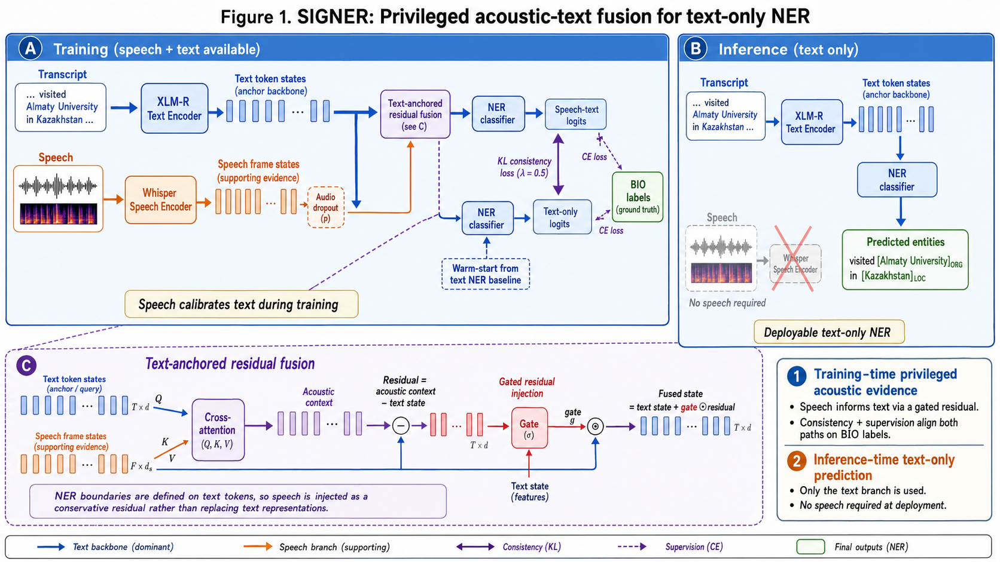

<div align="center">

# SIGNER

### Privileged Acoustic–Text Fusion for Low-Resource Multilingual Named Entity Recognition

[](https://www.python.org/)
[](https://pytorch.org/)
[](LICENSE)
[](docs/DATA.md)

**Speech guides training. Text alone is used at inference.**

</div>

<p align="center">
  
</p>

## Overview

SIGNER (**S**peech-**I**nformed **G**uided **N**amed **E**ntity
**R**ecognition) is a privileged acoustic–text learning framework for
multilingual NER. During training, a frozen speech encoder provides acoustic
evidence to a multilingual text encoder through text-anchored residual fusion.
A shared NER head and a cross-view consistency objective transfer this evidence
to the text pathway. At deployment, SIGNER requires only text.

This repository provides:

- the core SIGNER implementation;
- text-only and speech-informed training configurations;
- exact-span evaluation code;
- a small, human-verified CA-STNER annotation sample;
- dataset documentation and annotation guidelines;
- reproducibility and release-integrity checks.

> Experimental result tables are intentionally withheld from this initial
> public snapshot and will be added with the final paper release.

## Why SIGNER?

Conventional spoken NER either depends on an ASR pipeline or requires audio at
inference. SIGNER instead treats speech as **privileged training-time
information**:

```text
Training:   transcript + paired speech ──► SIGNER ──► NER supervision
Inference:  transcript only            ──► text path ──► entities
```

The text tokens remain the decision anchor. Acoustic features enter as a gated
residual correction, while symmetric KL consistency aligns the speech–text and
text-only predictions.

## Repository layout

```text
.
├── assets/                     # Method overview
├── configs/
│   ├── ca_stner_text_xlmr.yaml # Matched text-only baseline
│   └── ca_stner_signer.yaml    # Main SIGNER configuration
├── data/ca_stner_sample/       # Five-language annotation sample
├── docs/
│   ├── ANNOTATION_GUIDELINES.md
│   ├── DATA.md
│   └── REPRODUCIBILITY.md
├── scripts/
│   ├── evaluate.py
│   ├── prepare_ca_stner.py
│   ├── train.py
│   └── verify_release.py
├── src/signer/                 # Model, fusion, data, losses, and utilities
└── tests/                      # Lightweight release checks
```

## Installation

We recommend Python 3.10 and a CUDA-capable environment for training.

```bash
git clone https://github.com/PaErHaTi-DUTiR/SIGNER-main.git
cd SIGNER-main

conda create -n signer python=3.10 -y
conda activate signer
pip install -r requirements.txt
pip install -e .
```

`ffmpeg` is required for decoding MP3 and WAV audio:

```bash
conda install -c conda-forge ffmpeg -y
```

The public configs use Hugging Face model identifiers and download
`xlm-roberta-base` and `openai/whisper-small` on first use. Local model
directories can be substituted in the YAML files for offline execution.

## CA-STNER sample

CA-STNER covers five Central Asian languages:

| Code | Language | Script |
|:---:|---|---|
| `kk` | Kazakh | Cyrillic |
| `ky` | Kyrgyz | Cyrillic |
| `tg` | Tajik | Cyrillic |
| `tk` | Turkmen | Latin |
| `uz` | Uzbek | Latin |

The released sample contains one human-verified record per language with
character offsets and PER/LOC/ORG labels. Audio is not redistributed in this
lightweight sample; the metadata preserves the expected relative audio path.
See [Data documentation](docs/DATA.md) and the
[annotation guidelines](docs/ANNOTATION_GUIDELINES.md).

Validate the sample:

```bash
python scripts/verify_release.py
```

## Preparing the full dataset

After obtaining the full CA-STNER release, place it as follows:

```text
data/ca_stner/
├── kk/{train,dev,test}.jsonl
├── ky/{train,dev,test}.jsonl
├── tg/{train,dev,test}.jsonl
├── tk/{train,dev,test}.jsonl
├── uz/{train,dev,test}.jsonl
└── <language>/audio/...
```

Convert the public annotation format into the internal SIGNER format:

```bash
python scripts/prepare_ca_stner.py \
  --input-root data/ca_stner \
  --output-root data/ca_stner_signer \
  --validate
```

## Training

First train the matched text-only model:

```bash
python scripts/train.py \
  --config configs/ca_stner_text_xlmr.yaml \
  --device cuda:0
```

Then train SIGNER using the text-only checkpoint as initialization:

```bash
python scripts/train.py \
  --config configs/ca_stner_signer.yaml \
  --init-checkpoint outputs/ca_stner/text_xlmr/signer_last.pt \
  --device cuda:0
```

The main configuration uses XLM-R-base, a frozen Whisper-small encoder,
text-anchored residual fusion, ten epochs, AdamW, a learning rate of
`1e-5`, consistency weight `0.5`, and audio dropout `0.1`.

## Evaluation

SIGNER is evaluated through the text-only view:

```bash
python scripts/evaluate.py \
  --config configs/ca_stner_signer.yaml \
  --checkpoint outputs/ca_stner/signer/signer_last.pt \
  --split test \
  --view text-only \
  --output-json outputs/ca_stner/signer/test_text_only.json \
  --device cuda:0
```

The evaluator reports entity-level exact-match precision, recall, and F1. A
prediction is correct only if both its span boundary and entity type match the
reference annotation.

For complete protocol details, see
[Reproducibility](docs/REPRODUCIBILITY.md).

## Reproducibility checklist

- [x] Fixed train/dev/test split interface
- [x] Seeded training
- [x] Matched text-only baseline
- [x] Public hyperparameter configurations
- [x] Exact-span evaluation implementation
- [x] Dataset schema and integrity checks
- [x] Text-only deployment path
- [ ] Full dataset download link — added with the archival release
- [ ] Checkpoint download link — added with the final paper release
- [ ] Paper result tables — added with the final paper release

## Citation

If you use SIGNER or CA-STNER, please cite the accompanying paper. A
machine-readable citation record is available in [CITATION.cff](CITATION.cff).
The final venue, year, and DOI will be updated after publication.

## License

The SIGNER source code is released under the [MIT License](LICENSE).
CA-STNER annotations and audio remain subject to their own release terms and
the licenses of the underlying speech sources; see [docs/DATA.md](docs/DATA.md).
Third-party pretrained models are not redistributed by this repository.

## Contact

For questions about the code or dataset, please open a
[GitHub issue](https://github.com/PaErHaTi-DUTiR/SIGNER-main/issues).
